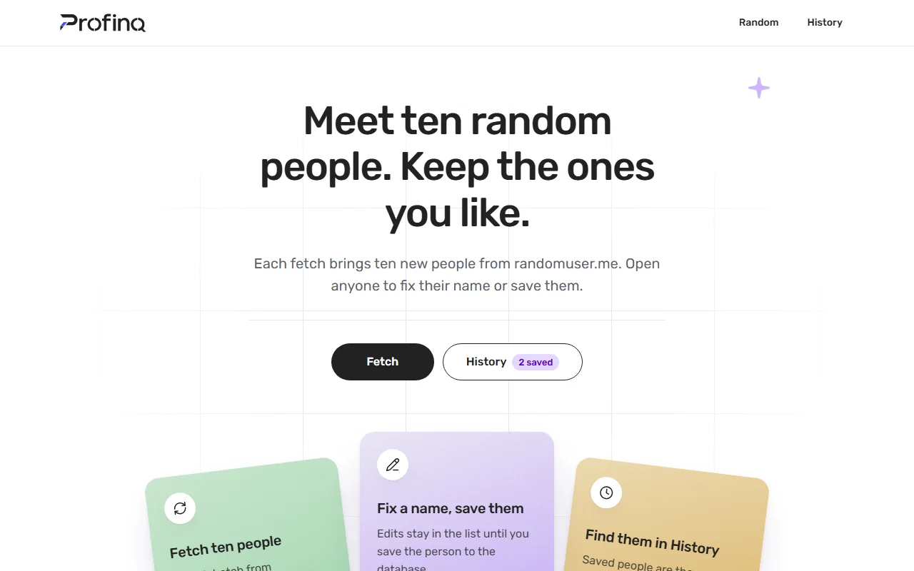
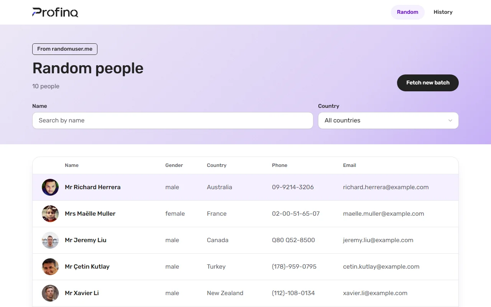
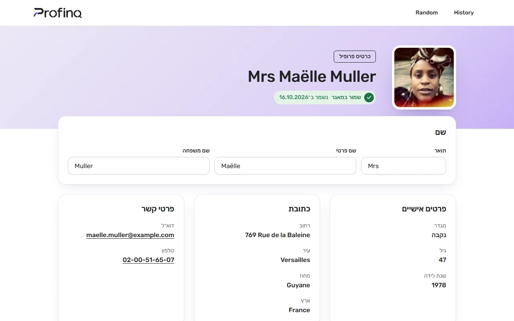
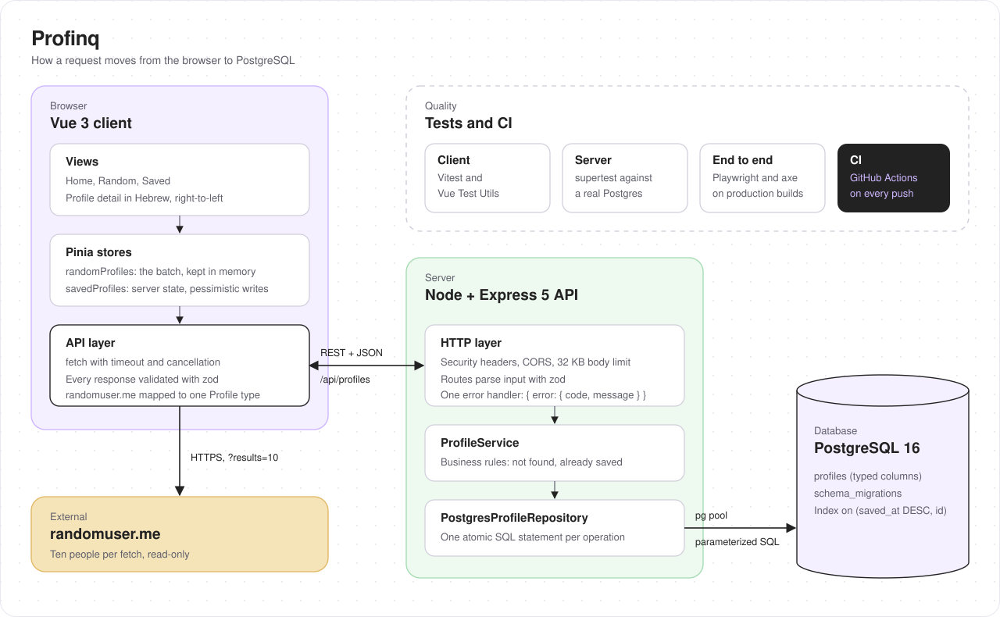

<p align="center">
  <picture>
    <source media="(prefers-color-scheme: dark)" srcset="docs/brand/profinq-logo-dark.svg" />
    
  </picture>
</p>

<p align="center">
  Meet ten random people, fix their names, and keep the ones you like.<br />
  A Vue 3 client and a Node + TypeScript API backed by PostgreSQL.
</p>

<p align="center">
  
  
  
</p>

---

Profinq is my solution to the [action-item](https://action-item.co.il) full-stack home assignment. It pulls people from [randomuser.me](https://randomuser.me), lets you filter and edit them, and saves the ones you choose through a small REST API into PostgreSQL. The profile screen is in Hebrew and runs right-to-left, while the Latin data on it (names, emails, phone numbers) stays left-to-right. The visual style follows [finqai.co.il](https://finqai.co.il).

The reasoning behind the main choices is in [DECISIONS.md](DECISIONS.md), and how I used AI is in [AI_USAGE.md](AI_USAGE.md).

## Screens

| Screen     | Route                       | What you can do                                                                 |
| ---------- | --------------------------- | ------------------------------------------------------------------------------- |
| 0. Home    | `/`                         | **Fetch** ten new people, or open **History**                                   |
| 1. Random  | `/random`                   | Browse the batch, filter by name and country (the filter lives in the URL)      |
| 2. History | `/saved`                    | The same list, loaded from the database 20 at a time                            |
| 3. Profile | `/random/:id`, `/saved/:id` | Edit any field, then **Save**, **Update** or **Delete** (Hebrew, right-to-left) |

Save appears only for people who are not in the database yet, and Delete only for people who are. Update writes to the database for saved people, and to the in-memory list for everyone else.

## Getting started

You need **Node.js 20.11+** (22 LTS recommended, see `.nvmrc`) and **Docker** for PostgreSQL. An existing PostgreSQL 14+ works too.

```bash
# 1. PostgreSQL 16, with the dev database and the two test databases
docker compose up -d

# 2. The API, on http://localhost:4000 (migrations run on startup)
cd server
cp .env.example .env
npm install
npm run dev

# 3. The client, on http://localhost:5173 (in a second terminal)
cd client
npm install
npm run dev
```

Open http://localhost:5173 and press **Fetch**.

If port 5432 is taken, start the database with `POSTGRES_PORT=5433 docker compose up -d` and change the port in `server/.env`. To look at the data, connect any SQL client to `localhost:5432`, database `profiles`, user and password `profiles`.

## Deploy to Vercel

`vercel.json` deploys both packages as one Vercel project with two [services](https://vercel.com/docs/services) on one domain: `client` (the Vite build) serves every path, and `server` (Express, as a Vercel Function from `server/src/serverless.ts`) serves `/api/*`. The browser calls the API on the same origin, so no CORS setup is needed.

1. Import the repository in Vercel.
2. Add a Postgres database from the Vercel Marketplace (Neon); it sets `DATABASE_URL`. Do this before the first deploy: the server's build step (`npm run migrate`) applies the migrations, once per deploy rather than on every cold start.
3. Set `TRUST_PROXY_HOPS=1`, so rate limits see the real client IP behind Vercel's proxy, and optionally `DB_POOL_SIZE=3`: every function instance has its own pool.

## Architecture

<p align="center">
  
</p>

The client talks to two backends. randomuser.me is called straight from the browser, and every record is validated before the app sees it. The Profinq API sits behind `/api` (Vite proxies it in development, so there is no CORS setup locally). On the server, each request goes route → zod validation → `ProfileService` → `PostgresProfileRepository`, and every write is a single atomic SQL statement, so a double click can never create two rows.

| Folder               | What's inside                                                       | Read more                            |
| -------------------- | ------------------------------------------------------------------- | ------------------------------------ |
| [`client/`](client/) | Vue 3, TypeScript, Pinia, Vue Router, shadcn-vue on Tailwind CSS v4 | [client/README.md](client/README.md) |
| [`server/`](server/) | Node, Express 5, `pg`, zod                                          | [server/README.md](server/README.md) |
| [`e2e/`](e2e/)       | Playwright end-to-end and accessibility tests                       | [e2e/README.md](e2e/README.md)       |
| `docker-compose.yml` | PostgreSQL 16 for development and tests                             |                                      |

## Tests

Every package has an `npm run check` that runs the type checker, ESLint, Prettier and its tests.

| Where     | Command         | Covers                                                                              |
| --------- | --------------- | ----------------------------------------------------------------------------------- |
| `server/` | `npm run check` | 162 tests: API, validation, pagination and query plans on a real PostgreSQL         |
| `client/` | `npm run check` | 150 unit and component tests (form rules, stores, API adapters, the profile screen) |
| `e2e/`    | `npm test`      | 48 Playwright runs on production builds, desktop and mobile, with axe               |

GitHub Actions runs all three on every push ([`.github/workflows/ci.yml`](.github/workflows/ci.yml)).

## Author

Designed and built by **Alon Iozef**.
